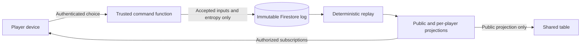

# Nuns on the Run — MVP design

## Product and scope

The MVP is a complete multiplayer implementation of the standard Mayfair game: friends gather, choose roles, play a full pursuit through the abbey, resolve victory, and play again. Support 2–8 human players on phones, tablets, and laptops, plus a shared 55-inch touch table with private information on players' phones. [VISION.md](VISION.md) defines the end experience; [MVP_PRD.md](MVP_PRD.md) defines product requirements; [RULES.md](RULES.md) identifies the rules baseline.

Include the complete board, objectives, blessings, patrol routes, movement, visibility, hearing, capture recovery, turn limit, and victory/tiebreak handling. Players need neither paper logs nor an external referee. Provide a readable board, finished accessible controls, and prompts written for players. Original schematic artwork may represent the board faithfully without copying publisher artwork.

Exclude bots, matchmaking, ranked play, chat, expansions, optional variants, asynchronous notifications, and account registration. Internet connectivity is required. Browser identity survives reload; recovering a lost identity on another device is outside this MVP. Device interruption must not lose a match or take a player's turn automatically.

**Implementation status:** existing code implements only table creation, joining, live roster updates, and browser-seat restoration. PR1 is the first increment toward this design. Gameplay, the trusted command service, protected views, and the acceptance journeys below are required before the product is an MVP.

## From invitation to another game

1. Enter a name, create a named table, and invite friends through a short code, QR code, or link. Pair the shared display separately; it never consumes a player seat.
2. Fill 2–8 seats. Assign novice and guard roles, with both guards under one player where required and separate guard players in the eight-player game. Show legal configurations and require everyone to confirm readiness. Membership or role changes clear readiness. Only the host can start a valid, ready group.
3. Freeze participants and roles. Generate protected setup randomness once, assign components deterministically, and show each player only their own setup information. Explain their objective and first decision in context.
4. Play all phases through novice or guard victory. Show whose decisions are needed, what has become public, and the current player's legal choices. Keep private planning private until its permitted reveal point.
5. Show the result and its explanation. Offer full route replay only after every participant explicitly consents to reveal private history; otherwise retain role-scoped history. A rematch creates a fresh game and seed, with a new invitation and readiness confirmation. Completed logs remain immutable.

Before start, players can leave and the host can close the table; host departure closes an unstarted table. After start, retain seats and wait for missing players to reconnect. There is no automatic substitution or forfeit. Any participant can propose abandoning the match; everyone must confirm. The group may instead create another table without altering the interrupted game.

## Play surfaces

| Surface | Information and controls |
| --- | --- |
| Novice device | Public abbey plus own position, objective, keys, blessing, private route history, movement selection, and confirmation. Other novices' secrets are absent. |
| Guard device | Public clues, patrol information, permitted guard cards/blessings, and controls for the assigned guard or guards. No hidden novice positions, objectives, or routes are delivered. |
| Shared table | Public board, visible figures, revealed movement cards, clues, capture count, turn information, and waiting/connection notices. Touch supports inspection and public route drafting; the owning player's phone confirms game decisions. |

Every personal device supports the full game without the shared screen. Phones provide pan/zoom and large location targets, with route review before confirmation. Laptops add keyboard and mouse operation. The tabletop supports multiple viewing directions, board rotation, and controls within comfortable reach. Private prompts and notifications must not expose secrets on shared screens or lock screens.

Provide public history of permitted observations and private history for each player. Distinguish submitted, accepted, rejected, disconnected, and waiting states in player language. Animations follow confirmed changes and can be reduced without obscuring results. Raw events, seeds, UIDs, and transport diagnostics belong in developer tools, not normal gameplay.

## Rules engine and decision flow

Use one pure TypeScript rules engine shared by the trusted service, replay tooling, and tests. Inputs are a versioned component manifest and accepted facts; outputs are game state and legal decision opportunities. The manifest defines location IDs, edges/doors, visibility geometry and exceptions, patrol routes, all cards, and objective locations. Rendering uses the same IDs. Validate the manifest against the selected rulebook before gameplay acceptance.

| Stage | Decisions and resolution |
| --- | --- |
| Setup | Freeze ready roles; derive component assignment from the protected seed and pinned shuffle algorithm. Do not log drawn cards as additional events. |
| Novice movement | Privately select movement type and an explicit ordered route. Validate every traversed edge and intermediate sighting, locked access, required stops, and caught restrictions. Preserve the special opening movement sequence. Never reveal another novice's submission early. |
| Novice noise | Reveal movement information at its permitted boundary; derive hearing checks from deterministic randomness and movement. Ask the responsible novice to choose noise direction(s) where equal shortest paths offer a choice. |
| Guard movement | Choose movement mode, patrol, and explicit route steps. Resolve sight and capture at each relevant step/turn so later pursuit choices can respond to new clues. Enforce facing, speed, movement completion, and patrol departure/return. |
| Guard hearing | Reveal guard movement, expire clues at the specified boundary, and derive hearing checks. Resolve remaining player-controlled noise placement choices before progressing. |
| Blessings and recovery | Offer every base-game blessing at its legal timing window and record its use/targets. Derive effects, exhaustion, retained keys, lost wish progress, and caught-status recovery. |
| End conditions | Derive the capture threshold, novice completion and published tiebreak, and turn-limit result at the correct boundary. If the published tiebreak still leaves equality, show shared winners; this final equality policy is an explicit digital convention. |

Automatic consequences are engine transitions, not fabricated events or extra confirmations. Advance immediately when accepted inputs make the next state unambiguous; stop for genuine player choices. Do not ask players to confirm computed sightings, captures, dice, scores, or victory. No elapsed-time gameplay transitions or artificial waits are needed.

## Authority and private information

Keep the TypeScript/Vite client static on GitHub Pages. Firebase Anonymous Auth identifies players and paired displays. Firestore stores the canonical log and distributes authorized views. A trusted Firebase HTTPS callable command function verifies identity, validates choices using the engine, serializes accepted inputs, and updates projections. Clients cannot append gameplay facts directly or read the complete canonical log. [Firebase callable functions](https://firebase.google.com/docs/functions/callable) provide the authenticated command boundary.

Generate a private setup/game seed on the trusted service. PR1's public lobby seed must never determine hidden information. Pin the rules, manifest, PRNG, shuffle algorithm, and canonical order of random draws at creation. Complete protected replay must reproduce every assignment, roll, observation, and result without fresh randomness. Reject illegal commands without revealing hidden facts through different error messages.

Selectors produce separate public, novice, and guard views. Firestore rules limit private views to their UID and public views to admitted players/paired displays. Omit hidden fields entirely: unrevealed cards, predictive seeds, private action counts, and other players' movement submissions must never reach unauthorized clients. Exclude secrets from URLs, bundles, analytics, errors, and public logs. Update public projections only when information is permitted to become public.

## Event and persistence contract

Use isolated PR and production namespaces: `environments/{environment}/tables/{id}`, containing protected `events`, server-owned coordination, and audience-specific `views`. The **event log** contains accepted user inputs and one-time nondeterministic facts only. Mutable heads, board state, readiness displays, legal options, public history, and result summaries are disposable projections outside that log and must be rebuildable. Never put secret gameplay inputs into PR1's public lobby collection.

| Fact family | Recorded input |
| --- | --- |
| Table/lobby | Create name, join/leave, role selection, readiness choice, display pairing, and host start/close intent. |
| Game initialization | Immutable version identifiers and one protected seed generated once for the game. Component assignments remain derived. |
| Novice decisions | Movement type and ordered route; selected noise direction(s); blessing identity and chosen targets. |
| Guard decisions | Assigned guard, movement choice, patrol selection, next route step, blessing use and targets. |
| Session decisions | Abandon proposal/consent, postgame reveal consent, and rematch request. |

Envelopes contain schema version, immutable event ID, actor UID, request ID, and predecessor identity. Ordering and attribution are protocol metadata, not computed game outcomes. A submitted decision reference identifies the opportunity acted on; do not replace it with a derived turn/phase snapshot. There are no `NoviceSpotted`, `Captured`, `DiceRolled`, `TurnAdvanced`, or `GameWon` outcome events.

Persist request ID and exact payload on the device before sending. The service checks idempotency and decision ownership, replays protected history, validates the input, then atomically appends the fact, advances coordination, and writes authorized projections using a [Firestore transaction](https://firebase.google.com/docs/firestore/manage-data/transactions). Generate entropy once outside transaction retries and reuse it. A conflicting head causes revalidation. Duplicates return existing acceptance; reused IDs with different payloads fail. Two tabs cannot take the same decision twice.

Parallel novice inputs remain separate immutable decisions with a deterministic resolution barrier. Accept different novices' inputs while that barrier is open, but reject second moves and stale submissions after resolution. No caller can rewrite a fact, refresh its timestamp, or silently amend a confirmed route. Drafts can be edited; committed decisions have no undo in the MVP because information may already have been revealed.

## Recovery and operation

On reconnect, authenticate the same UID, resubscribe to its permitted projection, and reconcile persisted pending requests by exact ID and payload before allowing another decision. Cached state permits inspection during an outage; only a confirmed synchronized view permits submission. Show connectivity explicitly. The service owns progress, so the host can disconnect during play without losing the game.

Stale commands receive safe conflict responses and refreshed permitted views. Unsupported versions block play with an update prompt. Keep historical rules replayable; never reinterpret old games with new rules. Projection repair replays the log and replaces caches without appending synthetic outcomes.

Run all development tools through the locked Nix flake. Deploy Firebase rules and Auth through the CLI, and deploy the command service before a preview offers gameplay. Keep administrator credentials out of Pages and frontend CI builds. Production and PR data must be isolated, with admission and view rules verified in each namespace. Existing PR1 lobby data remains a foundation demonstration; protected storage is a prerequisite for gameplay, not an existing feature.

Main and retained PR previews have their own static paths, namespace configuration, compatible engine versions, and reachable backends. Each gameplay increment must be manually exercisable through its preview, including reaching the new behavior through real player actions. Emulator fixtures and unit tests do not substitute for a working preview.

## MVP acceptance

- Two players can create, join, ready, start, and finish from separate phones. Eight can finish with split guard ownership. Other group sizes obey setup and seat limits.
- Complete journeys demonstrate novice victory, capture victory, turn-limit victory, every blessing, detection/hearing choices, patrol pursuit/return, and capture recovery. Rule-edge scenarios verify the component manifest.
- Replay accepted inputs and seed to reproduce every intermediate state and result. Events contain no computed outcomes; deleting/rebuilding projections preserves the game.
- Adversarial checks deny opponent/private-log reads, forged identities, unauthorized display actions, modified events, illegal decisions, duplicate/stale inputs, and cross-environment access. Inspect network payloads as well as rendered secrecy.
- Reloads, interruptions, two-tab races, and host disconnection preserve accepted decisions and seats. Rejected or retried requests never create a second move.
- Groups finish on mixed personal devices and around the real 55-inch table. Verify reach, orientation, legibility, keyboard operation, reduced motion, and explanations without an external referee.
- Deployed previews support these journeys through real actions. Follow [E2E_GUIDE.md](E2E_GUIDE.md): real emulators, `TestStepHelper` evidence, zero-pixel comparisons, and individual condition waits capped at 2000 ms. A lobby-only build does not satisfy MVP acceptance.
