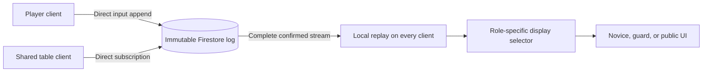

# Nuns on the Run — MVP design

## Product and scope

The MVP is a complete multiplayer implementation of the standard Mayfair game: friends gather, choose roles, play a full pursuit through the abbey, resolve victory, and play again. Support 2–8 human players on phones, tablets, and laptops, plus a shared 55-inch touch table with private information on players' phones. [VISION.md](VISION.md) defines the end experience; [MVP_PRD.md](MVP_PRD.md) defines product requirements; [RULES.md](RULES.md) identifies the rules baseline.

Include the complete board, objectives, blessings, patrol routes, movement, visibility, hearing, capture recovery, turn limit, and victory/tiebreak handling. Players need neither paper logs nor an external referee. Provide a readable board, finished accessible controls, and prompts written for players. Original schematic artwork may represent the board faithfully without copying publisher artwork.

Exclude bots, matchmaking, ranked play, chat, expansions, optional variants, asynchronous notifications, and account registration. Internet connectivity is required. Browser identity survives reload; recovering a lost identity on another device is outside this MVP. Device interruption must not lose a match or take a player's turn automatically.

**Implementation status:** existing code implements only table creation, joining, live roster updates, and browser-seat restoration. PR1 is the first increment toward this design. Full gameplay, client-side role views, and the acceptance journeys below are required before the product is an MVP.

## From invitation to another game

1. Enter a name, create a named table, and invite friends through a short code, QR code, or link. Pair the shared display separately; it never consumes a player seat.
2. Fill 2–8 seats. Assign novice and guard roles, with both guards under one player where required and separate guard players in the eight-player game. Show legal configurations and require everyone to confirm readiness. Membership or role changes clear readiness. Only the host can start a valid, ready group.
3. Freeze participants and roles. The host client generates and records the game seed once. Every client derives the same component assignments, then displays only the setup information appropriate to its role. Explain each player's objective and first decision in context.
4. Play all phases through novice or guard victory. Show whose decisions are needed, what has become public, and the current player's legal choices. Keep private planning private until its permitted reveal point.
5. Show the result and its explanation. Offer full route replay only after every participant explicitly consents to reveal private history; otherwise retain role-scoped history. A rematch creates a fresh game and seed, with a new invitation and readiness confirmation. Completed logs remain immutable.

Before start, players can leave and the host can close the table; host departure closes an unstarted table. After start, retain seats and wait for missing players to reconnect. There is no automatic substitution or forfeit. Any participant can propose abandoning the match; everyone must confirm. The group may instead create another table without altering the interrupted game.

## Play surfaces

| Surface | Information and controls |
| --- | --- |
| Novice device | Public abbey, **both guards' current positions and facing at all times**, plus own position, objective, keys, blessing, private route history, movement selection, and confirmation. Guard visibility does not depend on the novice's line of sight. Other novices' secrets are filtered from the display. |
| Guard device | Both guards' positions/facing, public clues, patrol information, permitted guard cards/blessings, and controls for the assigned guard or guards. Hidden novice positions, objectives, and routes are filtered from the display. |
| Shared table | Both guards' positions/facing, legally visible novice figures, revealed movement cards, clues, capture count, turn information, and waiting/connection notices. Its public selector filters all private information from the display. Touch supports inspection and public route drafting; the owning player's phone confirms game decisions. |

Every personal device supports the full game without the shared screen. Phones provide pan/zoom and large location targets, with route review before confirmation. Laptops add keyboard and mouse operation. The tabletop supports multiple viewing directions, board rotation, and controls within comfortable reach. Private prompts and notifications must not expose secrets on shared screens or lock screens.

Provide public history of permitted observations and private history for each player. Distinguish submitted, accepted, rejected, disconnected, and waiting states in player language. Animations follow confirmed changes and can be reduced without obscuring results. Raw events, seeds, UIDs, and transport diagnostics belong in developer tools, not normal gameplay.

## Rules engine and decision flow

Use one pure TypeScript rules engine shared by every client, replay tooling, and tests. Inputs are a versioned component manifest and accepted facts; outputs are game state and legal decision opportunities. The manifest defines location IDs, edges/doors, visibility geometry and exceptions, patrol routes, all cards, and objective locations. Rendering uses the same IDs. Validate the manifest against the selected rulebook before gameplay acceptance.

| Stage | Decisions and resolution |
| --- | --- |
| Setup | Freeze ready roles; derive component assignment from the recorded seed and pinned shuffle algorithm. Do not log drawn cards as additional events. |
| Novice movement | Privately select movement type and an explicit ordered route. Validate every traversed edge and intermediate sighting, locked access, required stops, and caught restrictions. Preserve the special opening movement sequence. Never reveal another novice's submission early. |
| Novice noise | Reveal movement information at its permitted boundary; derive hearing checks from deterministic randomness and movement. Ask the responsible novice to choose noise direction(s) where equal shortest paths offer a choice. |
| Guard movement | Choose movement mode, patrol, and explicit route steps. Resolve sight and capture at each relevant step/turn so later pursuit choices can respond to new clues. Enforce facing, speed, movement completion, and patrol departure/return. |
| Guard hearing | Reveal guard movement, expire clues at the specified boundary, and derive hearing checks. Resolve remaining player-controlled noise placement choices before progressing. |
| Blessings and recovery | Offer every base-game blessing at its legal timing window and record its use/targets. Derive effects, exhaustion, retained keys, lost wish progress, and caught-status recovery. |
| End conditions | Derive the capture threshold, novice completion and published tiebreak, and turn-limit result at the correct boundary. If the published tiebreak still leaves equality, show shared winners; this final equality policy is an explicit digital convention. |

Automatic consequences are engine transitions, not fabricated events or extra confirmations. Advance immediately when accepted inputs make the next state unambiguous; stop for genuine player choices. Do not ask players to confirm computed sightings, captures, dice, scores, or victory. No elapsed-time gameplay transitions or artificial waits are needed.

## Trusted clients and display filtering

Keep the TypeScript/Vite client static on GitHub Pages. Firebase Anonymous Auth identifies players and paired displays. Clients append input facts directly to Firestore and subscribe directly to its confirmed event log. Every admitted player and display client receives the complete game stream, including all routes, objectives, blessings, and the seed, and replays it locally. **There are no Cloud Functions, command APIs, or application servers in the implementation.** Game validation, deterministic consequences, and view selection run in browsers without an extra server round trip.

Generate the game seed once in the host client and record it with the start decision. Rematches use fresh seeds. Pin the rules, manifest, PRNG, shuffle algorithm, and canonical order of random draws. Every browser must reproduce all assignments, rolls, observations, and results without fresh randomness during replay. Client validation checks identity, role, phase, and legality before appending and validates the stream again during replay; inconsistent history blocks play with a diagnostic instead of producing divergent boards.

All participants, including the shared display, use the same selector boundary before rendering. A novice selector includes both guards and that novice's private information; a guard selector includes public observations and its permitted guard information; the table selector includes public information only. Apply filtering to maps, histories, legal-action hints, cards, status messages, animations, and notifications, not just tokens. Do not put the unfiltered state in the DOM or normal UI diagnostics. Postgame reveal consent changes what selectors display, not which facts clients can download.

The MVP assumes trusted participants and client software. Client-side filtering preserves the intended play experience; it does not conceal facts or future randomness from someone inspecting browser state, network traffic, or developer tools. Firestore rules enforce authenticated table access, attributed writes, event shape, and immutability, not confidential role-specific delivery or the full board-game rules. Paired displays can read the stream but cannot submit player decisions.

## Event and persistence contract

Use isolated PR and production namespaces: `environments/{environment}/tables/{id}`, containing immutable `events` and minimal coordination/admission records. All admitted clients read the full stream. The **event log** contains accepted user inputs and one-time nondeterministic facts only. Board state, readiness displays, legal options, histories, and results are disposable in-memory projections on each client, never stored outcome events. A mutable head containing the last event ID supports atomic appends; it is protocol coordination outside the log, not a saved board or turn.

| Fact family | Recorded input |
| --- | --- |
| Table/lobby | Create name, join/leave, role selection, readiness choice, display pairing, and host start/close intent. |
| Game initialization | Immutable version identifiers and a seed generated once by the host for the game. All clients derive component assignments. |
| Novice decisions | Movement type and ordered route; selected noise direction(s); blessing identity and chosen targets. |
| Guard decisions | Assigned guard, movement choice, patrol selection, next route step, blessing use and targets. |
| Session decisions | Abandon proposal/consent, postgame reveal consent, and rematch request. |

Envelopes contain schema version, immutable event ID, actor UID, request ID, and predecessor identity. Ordering and attribution are protocol metadata, not computed game outcomes. A submitted decision reference identifies the opportunity acted on; do not replace it with a derived turn/phase snapshot. There are no `NoviceSpotted`, `Captured`, `DiceRolled`, `TurnAdvanced`, or `GameWon` outcome events.

Persist request ID and exact user-input payload on the device before sending. The client validates against its complete confirmed log prefix. In a direct [Firestore transaction](https://firebase.google.com/docs/firestore/manage-data/transactions), read the request's event document and the current head. An existing matching event is an acknowledged duplicate; a reused ID with different input fails. Otherwise require the head to match the prefix already replayed locally, then atomically create the event and advance the head. No board computation, projection write, collection query, or external request is needed inside that transaction.

Firestore rules require each new event to reference the previous head, attribute it to the authenticated writer, and be linked by the head update in the same transaction. Deny updates/deletes of events and decisions from display-only members. Generate entropy once before transaction retries and reuse it. On a changed head, wait for the subscription to deliver the new prefix and revalidate the unchanged pending input. Retry only if it is still the same legal decision; otherwise ask for a fresh choice. Two tabs racing for one decision cannot apply it twice. Request identity and user input remain fixed across attempts; predecessor metadata is chosen for the successful append.

Parallel novice inputs remain separate immutable decisions with a deterministic resolution barrier. Serialize their Firestore appends through the head while allowing different novices' legal inputs during the same decision window. Every client derives when the barrier is complete. Reject second moves and stale submissions after resolution. No caller can rewrite a fact, refresh its timestamp, or silently amend a confirmed route. Drafts can be edited; committed decisions have no undo in the MVP because information may already have been revealed.

## Recovery and operation

On reconnect, authenticate the same UID, resubscribe to the complete event stream, replay the confirmed predecessor chain, and apply the device's role selector. Reconcile pending requests by exact ID and user-input payload before allowing another decision. Cached state permits inspection during an outage; only a confirmed synchronized prefix permits submission. Show connectivity explicitly. Firestore retains progress and every client can replay it, so the host can disconnect during play without losing the game or stopping another player's turn.

Stale inputs prompt replay of the latest confirmed stream and revalidation in the client. Unsupported versions block play with an update prompt. Keep historical rules replayable; never reinterpret old games with new rules. Repair a local projection by replaying the log without appending synthetic outcomes. Reconstruct the chain from predecessor identities, not timestamps, listener arrival order, or local pending writes.

Run all development tools through the locked Nix flake. Deploy Firebase rules and Auth through the CLI; these are the entire application backend. Keep administrator credentials out of Pages and frontend CI builds. Production and PR data must be isolated, with admission, event attribution, and atomic append rules verified in each namespace. Existing PR1 lobby data remains a foundation demonstration; the complete gameplay protocol and client-side selectors are still to be implemented.

Main and retained PR previews have their own static paths, namespace configuration, compatible engine versions, and reachable backends. Each gameplay increment must be manually exercisable through its preview, including reaching the new behavior through real player actions. Emulator fixtures and unit tests do not substitute for a working preview.

## MVP acceptance

- Two players can create, join, ready, start, and finish from separate phones. Eight can finish with split guard ownership. Other group sizes obey setup and seat limits.
- Complete journeys demonstrate novice victory, capture victory, turn-limit victory, every blessing, detection/hearing choices, patrol pursuit/return, and capture recovery. Rule-edge scenarios verify the component manifest.
- Replay accepted inputs and seed to reproduce every intermediate state and result. Events contain no computed outcomes; deleting/rebuilding projections preserves the game.
- Selector tests feed the same full state to novice, guard, and public clients. Both guards' actual positions/facing are always shown to novices; hidden novice information and unrevealed cards are filtered from the appropriate displays, histories, hints, and notifications. This tests display discipline, not network secrecy between admitted clients.
- Firestore checks deny nonmember/cross-environment reads, forged attribution, display-only decisions, event mutation, and non-atomic appends. Client engine tests reject illegal decisions and duplicate/stale inputs and prove identical replay on every participant.
- Reloads, interruptions, two-tab races, and host disconnection preserve accepted decisions and seats. Rejected or retried requests never create a second move.
- Groups finish on mixed personal devices and around the real 55-inch table. Verify reach, orientation, legibility, keyboard operation, reduced motion, and explanations without an external referee.
- Deployed previews support these journeys through real actions. Follow [E2E_GUIDE.md](E2E_GUIDE.md): real emulators, `TestStepHelper` evidence, zero-pixel comparisons, and individual condition waits capped at 2000 ms. A lobby-only build does not satisfy MVP acceptance.
