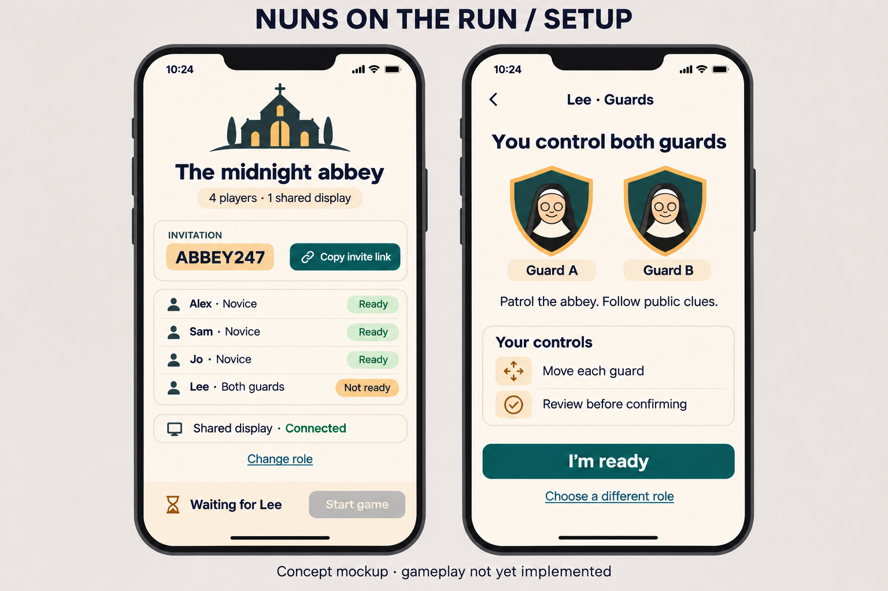
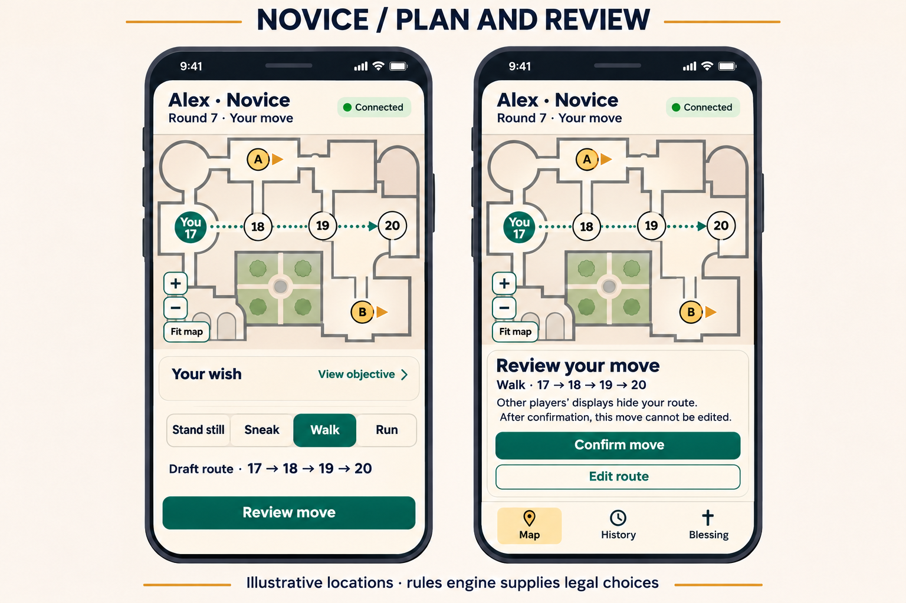
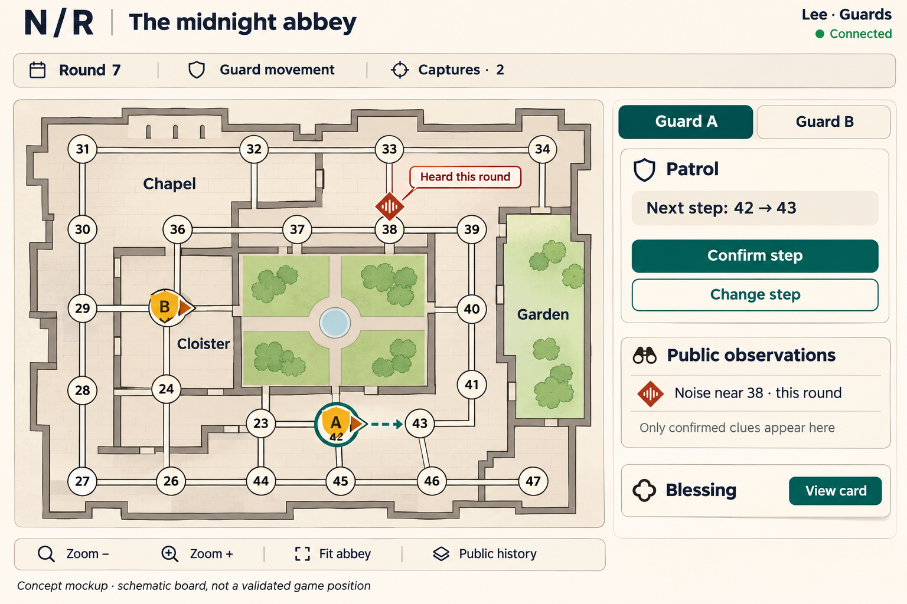
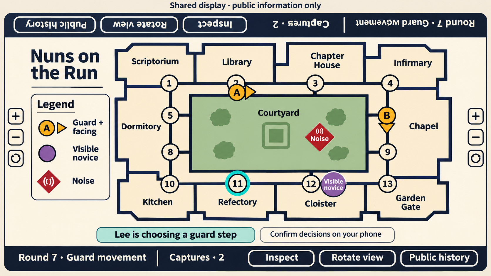

# Nuns on the Run — UX design

**Status: proposed game UI.** PR1 currently implements table creation, invitations, a live roster, and seat restoration. The mockups below show the intended complete game, not screenshots of implemented gameplay. [MVP_PRD.md](MVP_PRD.md) defines requirements; [MVP_DESIGN.md](MVP_DESIGN.md) defines behavior and persistence; [RULES.md](RULES.md) identifies the rules baseline.

The aim is to keep attention on the abbey: where to go, what the guards know, and whose decision comes next. Personal devices provide a complete game. The shared table adds a common board without replacing private controls.

## Visual language

Extend the existing lobby's warm paper background, dark green ink, bundled Inter typeface, and restrained rust accent. Use pale stone rooms and a muted green courtyard to make the map readable. Teal identifies the current selection; amber guard tokens always include facing arrows. Keep decoration outside paths and location targets.

| Element | Proposed treatment |
| --- | --- |
| Primary decision | One prominent, explicitly named button: “Review move”, “Confirm move”, or “Confirm step”. |
| Own novice | Filled circle, “You” label, and a distinct outline; private route uses a dashed line with ordered stops. |
| Guards | A/B labels, shield symbols, and directional arrows; color alone never identifies a guard or its facing. |
| Public clues | Sound-wave diamond for noise; visible novice figure with a name and explicit visibility state. |
| Draft versus confirmed | Dashed draft and a persistent “Draft” label; confirmed position uses a solid token. |
| Status | Short text with an icon: “Connected”, “Sending move”, “Move accepted”, or “Reconnecting”. |
| Cards | Readable title, effect, timing, and legal targets. Expand for details instead of squeezing card text onto the board. |

All boards in these images are **illustrative schematics**, not the validated abbey manifest or legal scenario fixtures. Location numbers demonstrate selection and review. Card faces and exact geometry need separate rules validation; no original publisher artwork is reproduced. The illustrations communicate layout and hierarchy; the behavior and labels specified here govern implementation.

## 1. Gather, choose roles, and ready

The lobby answers three questions in order: “Am I at the right table?”, “Who is here?”, and “Can we start?” Put the table name and invitation code above the roster. Copy link, QR invitation, and code entry offer equivalent ways to join; a QR image is not shown in this mockup. Pairing a shared display is a separate action and never adds a player seat.

Each roster row shows name, role, readiness, and connection state. A four-player example has three novices and one player controlling both guards. At eight players, show separate guard owners. Offer only configurations legal for the current 2–8 player group; explain why a role or start action is unavailable.

Role selection opens a short explanation on the player's own device. “I'm ready” is an explicit choice, not a side effect of joining. Membership or role changes clear readiness with an explanation. Only the host sees the enabled “Start game” action when the configuration is valid and everyone is ready; other players see who is still deciding. Before start, expose leave and host close actions with confirmation.

Starting leads to a private setup screen: own wish, required keys, home, blessing, and a first-action explanation for novices; patrol and permitted cards for guards. The shared display shows only the public start state. Nothing private appears in roster tooltips or join notifications.

## 2. Novice phone: plan, review, commit

Keep identity, round, current decision, and connection state at the top. Give the board most of the screen. A bottom sheet holds the current action; persistent tabs lead to map, role-scoped history, and blessing. The novice's own objective can expand without leaving the game.

**Both guards' current positions and facing are always available**, regardless of the novice's line of sight. When a zoomed crop places a guard outside the viewport, show a labeled edge indicator with facing and a jump-to-guard control. “Fit map” reveals both guards. Never substitute last-seen positions or uncertainty markers for their actual positions. Other novices' hidden positions, routes, wishes, and cards are absent.

The normal move follows this sequence:

1. Choose **Stand still, Sneak, Walk, or Run** from the engine's available choices. Explain applicable distances and restrictions beside the choice. The special opening sequence gets its own prompt rather than pretending it is an ordinary turn.
2. Tap connected locations to draft an ordered route. Show selected location numbers in a readable list as well as on the board. Offer step back, clear draft, zoom, and fit controls. Selecting a location inspects it; an explicit route action adds it, avoiding accidental moves while panning.
3. Choose “Review move”. The sheet repeats movement and every traversed location, with “Edit route” and “Confirm move”. Stand still reviews the current location without requiring a path.
4. On confirmation, show “Sending move”; keep the same request pending until its outcome is known. Show “Move accepted” only after confirmation. Then replace planning controls with the next genuine decision or a waiting message.

The draft is editable. A confirmed decision has no undo. Public movement reveals and observations appear only at their rules-defined boundary; another novice's submission must not reveal their choice early. Do not show invented sight percentages, future rolls, hidden-player hints, or target suggestions derived from another novice's secrets.

If noise has multiple legal directions, open a private “Choose where the noise is heard” sheet with only the legal alternatives and a review action. If a blessing is usable, show its actual effect and targets, then confirm the player's selection. Dice, detections, captures, and phase changes resolve automatically; they never get “Confirm result” buttons.

## 3. Guard laptop: board and decision together

On a laptop, put the board in the larger left pane and the current decision in a fixed right pane. Show public turn and capture information in a compact header. The sidebar groups the selected guard, movement or patrol choice, next step, permitted blessing, and public observations. The two-guard owner can switch between A and B; split owners can inspect both but act only for their assigned guard.

Guard movement proceeds at the engine's decision boundaries. The illustrated “Confirm step” accepts one next step, then updates permitted observations before offering the next choice. Do not commit a whole pursuit route past a point where a sighting could change the player's decision. Explain remaining movement and patrol departure/return restrictions in context.

The guard view contains legally visible novices and confirmed clues, never hidden novice tokens, secret objectives, private route trails, or heatmaps inferred from inaccessible information. Public history explains a clue's source and duration at the level the rules permit. Expired clues leave the current board at the proper boundary; history distinguishes past observations from current positions.

On a tablet, retain the board beside a narrower action pane when space permits; otherwise use the same bottom sheet as the phone. A guard on a phone has all the same decisions, not a reduced companion interface. A novice on a laptop gets this spatial layout with the novice selector and private action pane instead.

## 4. Shared 55-inch tabletop: public board

The board dominates the display. Compact edge strips repeat the round, phase, captures, and public waiting status toward opposite seats. Put inspection, public history, and local view rotation within reach at the edges; extend this to all seating sides during hardware validation. Location inspection opens near the touched edge rather than forcing a reach to the center.

Rotate the presentation without changing location identity, guard facing relative to the board, or the game state. Orientation belongs to this display; rotating it does not rotate anyone's phone. Pinch or explicit zoom controls support inspection, with a clear return to the whole abbey. Large targets and deliberate controls prevent several touches from becoming conflicting commands.

The table shows both guards, legally visible novices, revealed movement information, public clues, and the game's public status. It never shows private objectives, blessings, unrevealed submissions, private route previews, or a hidden-state debug panel. A public draft is visibly provisional; the owning player's phone reviews and confirms any game decision. The display itself has no player decision controls.

Messages say “Waiting for novice decisions” or “Lee is choosing a guard step” only when that information is public. The same restriction applies to animation timing, highlights, and history, not just text. Pairing a display never reveals an individual player's setup screen.

## 5. Interruptions and changed decisions

Keep status next to the current action, not in a disappearing toast. Preserve the last confirmed board and a readable explanation while connectivity changes.

| Situation | Message and behavior |
| --- | --- |
| Private draft | “Draft move”; editable until confirmed. Leaving the sheet does not submit it. |
| Awaiting acknowledgment | “Sending move”; prevent a second submission and preserve the pending request. |
| Accepted | “Move accepted”; show the confirmed projection and next decision. |
| Changed game state | “The game changed. Review your move again.” Preserve the intended input for review; do not silently replace the route. |
| Disconnected | “Reconnecting. You can inspect the board; moves are unavailable.” Disable submission until synchronized. |
| Reload with pending input | “Checking your last move”; reconcile it before enabling another decision. |
| Player absent | Public waiting notice where appropriate; retain the seat. No countdown, automatic turn, or automatic forfeit. |
| Unsupported game version | “This build cannot play this game's version.” Explain how to return to a compatible build; submit nothing. |

On capture, the novice gets a private recovery explanation: retained keys, lost wish progress, and how to return home. Show caught status and the legal recovery choices; the table shows only permitted public capture and visible-return information. No manual acknowledgment is required to compute the capture.

Any player may propose abandoning an interrupted match. Explain the consequence and gather every participant's explicit consent. Creating a different table remains possible without altering this game's history.

## 6. Finish, reveal, and rematch

The result screen keeps the board visible behind a concise result panel: winner or shared winners, the reason, and the applicable capture, turn-limit, or simultaneous-finish tiebreak explanation. It must explain the derived result without disclosing unrevealed personal routes or cards.

Offer “Keep routes private” and an explicit “Allow full route reveal” consent control. Until everyone consents, histories remain role-scoped and the shared display stays public. A participant can see that reveal consent is pending without seeing another player's route. Only unanimous consent enables the full route replay, with play/pause, step, and round controls; no timed animation is required to understand it.

“Request rematch” opens a new lobby with a fresh invitation and seed. Everyone confirms readiness again. Keep a link back to the immutable completed result. Do not reset the finished board in place or carry reveal consent into the next game.

## 7. Reach, access, and display filtering

Use at least 48 CSS-pixel action targets and 16-pixel body text on personal devices, with larger table targets validated on the real hardware. The map may use smaller location labels at overview scale, but selecting a location must expose readable text and a large target at inspection scale. Keep the action sheet clear of browser chrome and safe areas. Let text wrap and enlarge without hiding confirmation or closing controls.

Keyboard players can navigate a location list, inspect a location, add a legal step, review, and confirm without dragging. Give tokens descriptive accessible names including guard facing. Announce phase and request-status changes politely; avoid announcing every map redraw. Move focus into action sheets and restore it when they close. Never encode ownership, clues, invalid choices, or connection state through color or motion alone.

Reduced motion replaces travel animation with a direct confirmed-state update and textual explanation. Sound is optional. Private objectives, moves, and card names stay out of shared-screen and lock-screen messages. All rendered content—including accessible labels and hints—passes through the role selector. Trusted clients receive the whole log; these are display rules, not promises of network secrecy.

Production and PR previews open the same game using its table fragment. Switching to a compatible preview in the same browser profile restores the existing seat, history, and pinned rules. The normal UI should not expose Firestore paths, seeds, or raw events; preview build information belongs in an unobtrusive About view. Actions in a preview affect the live game, as described in [MVP_DESIGN.md](MVP_DESIGN.md).

## Review before implementation acceptance

- Play setup, movement review, noise choices, blessings, capture recovery, victory, and rematch on a phone without a table display.
- Feed the same game state to novice, guard, and public views. Check maps, cards, histories, accessible labels, prompts, and animations. Both guards and facing must remain available to novices at every zoom level.
- Verify rejected input, delayed acknowledgment, reload, reconnection, and two tabs cannot duplicate a decision or lose an accepted move.
- Switch an admitted player between compatible production and PR builds during a game without creating another seat or copying state.
- Test all seating sides on the actual 55-inch table: reach, orientation, accidental touches, glare, and readable board labels. A desktop viewport is insufficient evidence.
- Implemented journeys use [E2E_GUIDE.md](E2E_GUIDE.md): real emulators, `TestStepHelper`, waits capped at 2000 ms, and zero-pixel comparisons. These concept images are design assets, not visual test baselines.

## Mockup assets

The four images are generated concept illustrations using the built-in image generation tool. Their prompts are retained in [docs/ux/mockups/prompts.json](docs/ux/mockups/prompts.json). They establish a visual direction for review; implementation must preserve the role and rules constraints above rather than treating decorative map geometry as game data.
