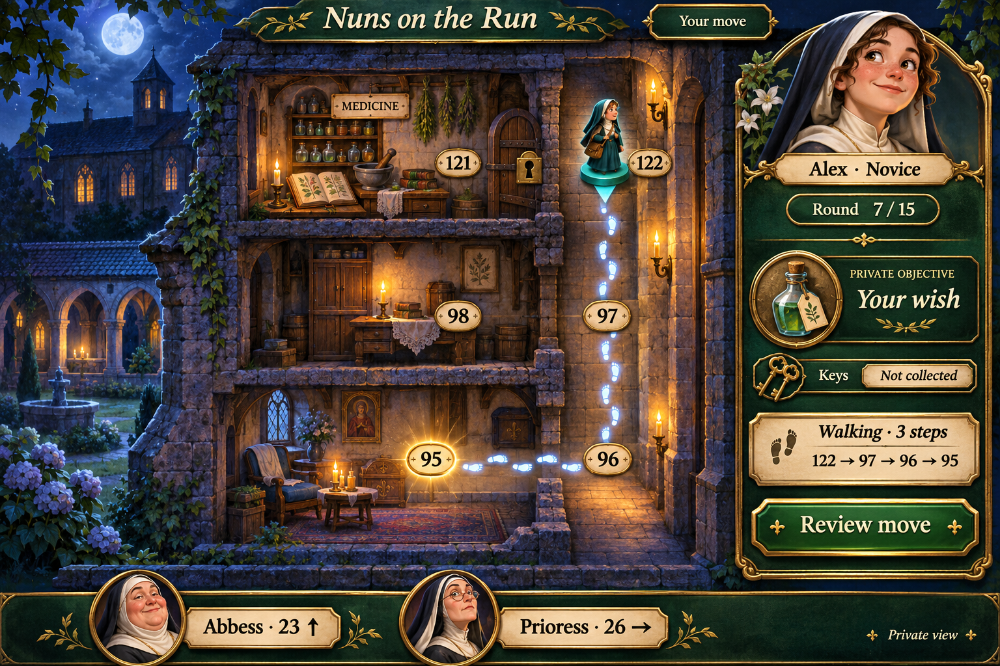
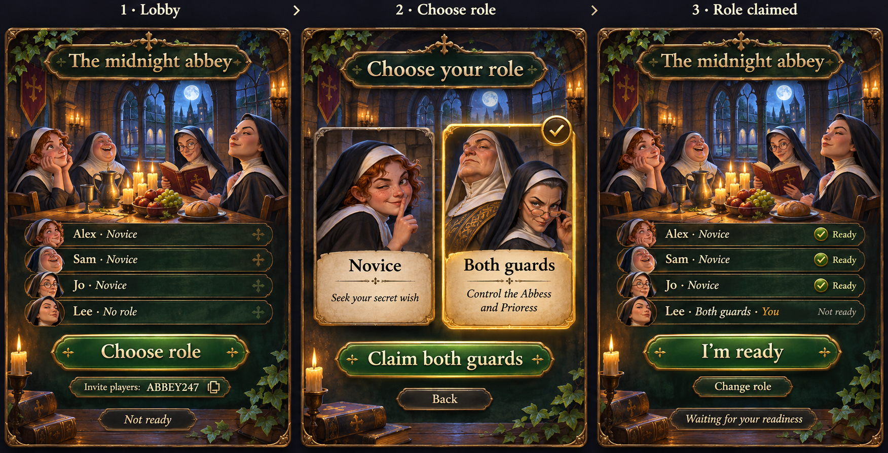
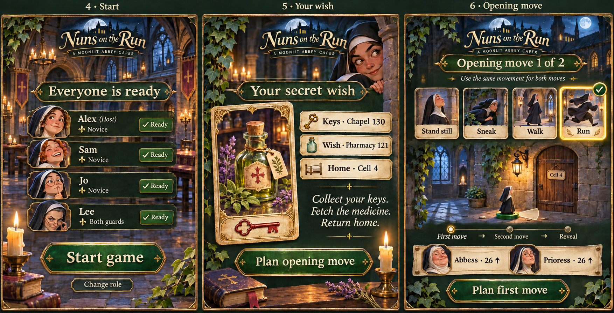
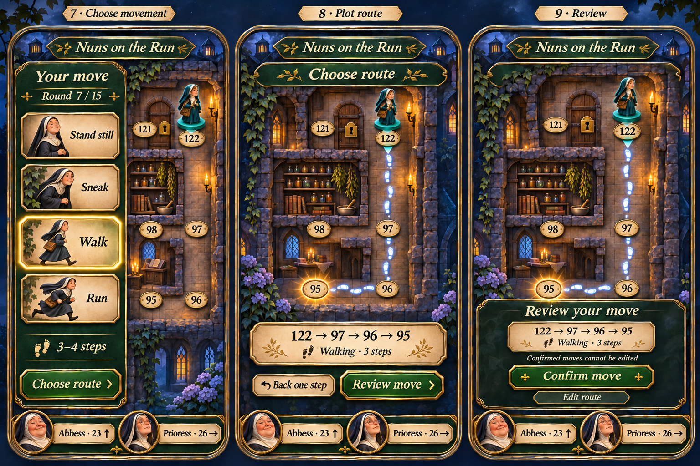
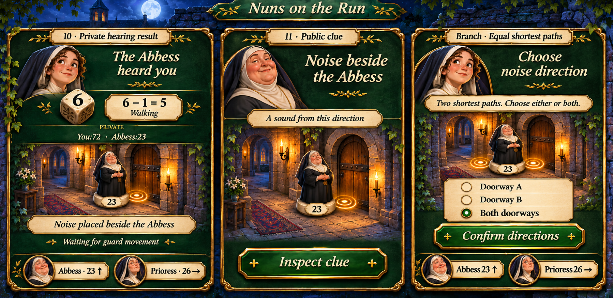
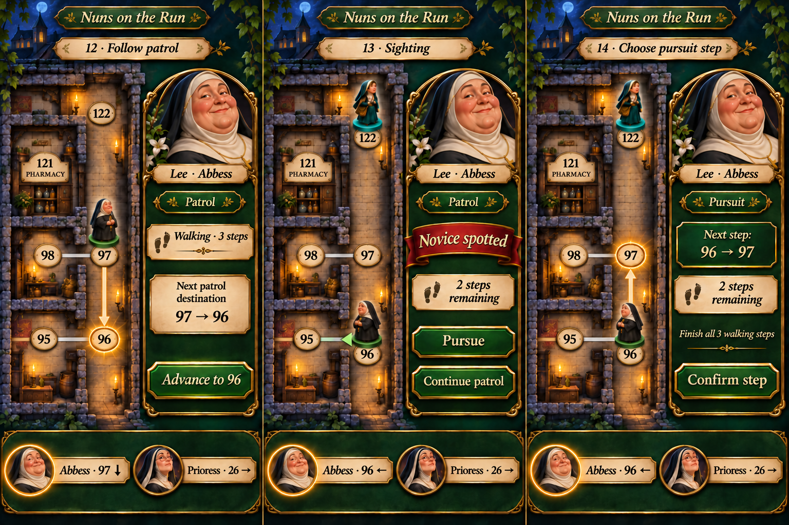
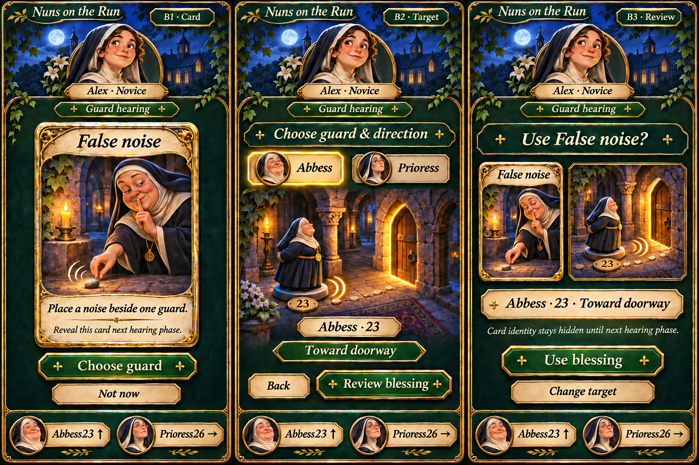
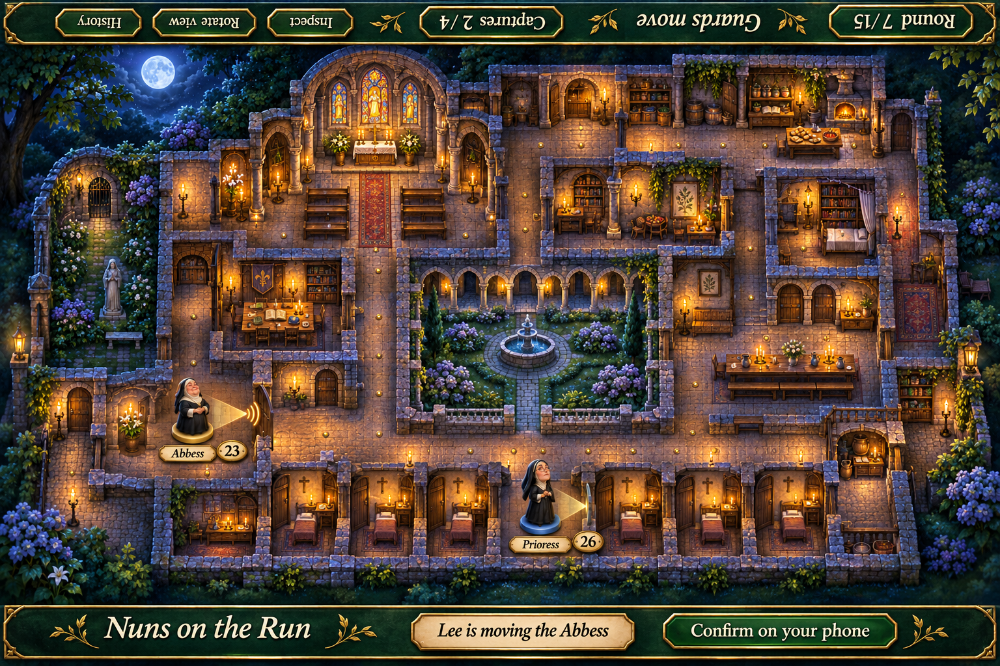
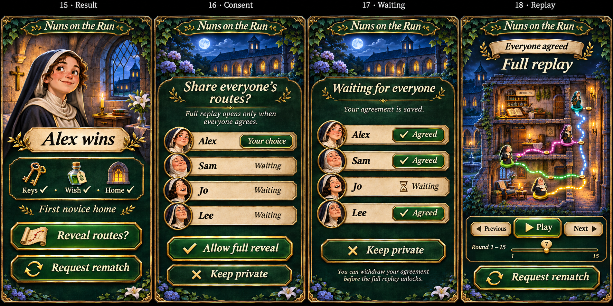

# Nuns on the Run — game experience and screen flows

**Proposed game UI, second visual pass.** The application still implements the PR1 lobby. These generated game screens describe the intended experience, not implemented gameplay. [MVP_DESIGN.md](MVP_DESIGN.md) defines behavior and persistence; [MVP_PRD.md](MVP_PRD.md) defines product requirements.

## Enter the abbey

The game should feel like sneaking through a place worth exploring. Moonlight catches ivy and roof tiles; candles light doorways; the abbess and prioress have different personalities. Miniatures, expressive portraits, and illustrated cards give the decisions character. Keep the humor in the nuns and the pursuit, and the playable surface clear.

Use original painted environments, dark green controls, aged brass accents, and warm ivory text. A shallow cutaway brings personal screens to life. The table uses an overhead view so walls, paths, and facing remain readable from different seats. Large portraits belong in role and card screens; movement gives most of the screen to the board.

The numbered images below show successive screens. Each table names the actual tap or click and its destination. A selected card is not a committed decision; a glowing route is a draft.

Setup forms one continuous journey. Sections C, D, and E each begin from their own stated midgame position; the numbering follows the interface tour rather than a single recorded match.

### Rules checked for this pass

Examples use the [Mayfair rulebook](https://mind-maze.uk/nuns-on-the-run/rules/notr-rules.pdf). References below are to **printed page numbers**. Local movement connections were checked against its pharmacy corridor illustration; the hearing example comes from its noise illustration. Publisher illustrations were inspected as references and are not saved in this repository.

| Rule | UI consequence |
| --- | --- |
| Hearing, pp. 4, 6–7 | Ordinary noise goes beside the listening guard, toward a shortest path to the novice. It does not mark the sound source. |
| Equal shortest paths, pp. 4, 7 | Offer either direction or both; without a choice, place the required token automatically. |
| Vanishing, pp. 3, 6 | A vanished marker belongs on the edge where the novice leaves sight. Give it a different silhouette from sound. |
| Opening, p. 2 | Explain two initial novice movements with one shared movement choice. |
| Pursuit, pp. 5–6 | A qualifying observation changes the affected guard's choices, not automatically both guards'. |
| Victory, p. 7 | Apply the published capture tiebreak, including shared winners if still tied. |

These are hand-authored interface states, not executable engine fixtures. Their checked local connections and clue anchors must survive implementation. The whole-board painting establishes art direction; the validated component manifest will supply every playable location, door, and visibility relation.

## A. Join → choose a role → become ready

The invitation screen asks for a name and code. **Join table** opens screen **1**; an invitation link pre-fills the code. Invalid or unknown codes keep the form and show an inline correction. Joining does not assign a role or imply readiness.

| Screen | Tap or click | Visible result |
| --- | --- | --- |
| **1 · Lobby** | **Choose role** | Open **2**, the role picker. |
| **2 · Choose role** | Tap **Both guards** | Highlight that card and show its explanation. No role is committed yet. |
| **2** | **Claim both guards** | Commit the choice; return to **3** with **Both guards · You** on Lee's row. |
| **2** | **Back** | Return to the lobby without a change. |
| **3 · Role claimed** | **I'm ready** | Save readiness; show **Ready ✓** and a **Not ready** action. Update the host's roster. |
| **3** | **Change role** | Reopen **2** with the current selection. A confirmed change clears readiness and explains who must ready again. |

Selecting **Novice** changes the confirmation button to **Claim novice**. This chooses a role, not a secret wish or favorable character. Setup assigns the private components after start.

The four-player example has three novices and one person controlling both guards. At eight players, the picker offers **Abbess** and **Prioress** separately instead of **Both guards**. Occupied roles show their owner and are unavailable. If a concurrent claim loses the race, keep the picker open with “Lee claimed that role. Choose another”; never silently assign a different role. Membership changes update legal roles and readiness. Enforce the eight-human-seat limit.

**Invite players** opens code, copy-link, and QR sharing options. **Pair shared display** opens a separate display invitation; acknowledgment appears below the roster and uses no player seat. Before start, **Leave table → leave confirmation** removes a guest; the host instead gets **Close table → close confirmation**, explaining the effect on everyone. During a game, seats survive disconnection.

## B. Start → receive your wish → plan the opening

| Screen | Tap or click | Visible result |
| --- | --- | --- |
| **4 · Start** | Host presses **Start game** | Freeze the ready group and roles. Each device opens its own setup; the table opens the public board. |
| **5 · Your wish** | **Plan opening move** | Open **6**, with the opening sequence above the movement cards. |
| **6 · Opening move** | Tap **Run**, then **Plan first move** | Open the route planner for movement 1; selecting a card alone submits nothing. |
| First route review | **Confirm first move** | After acknowledgment, open **Opening move 2 of 2** with the same movement fixed and a new draft. |
| Second route review | **Confirm second move** | After acknowledgment, show the accepted position and next required decision. |

The mission uses the rulebook's medicine example: keys at Chapel 130, wish at Pharmacy 121, home in Cell 4, with original card art. **Wish** reopens the private mission later with its progress. An expandable **Your blessing** opens the held card. Collecting an objective follows a legal ending location; there is no redundant “Collect” button. [Setup and objective example, pp. 2–3](https://mind-maze.uk/nuns-on-the-run/rules/notr-rules.pdf)

Guard setup presents **Abbess** and **Prioress** tabs with their separate blessings and **Choose patrol**. That button opens eligible patrol cards; select one, inspect its itinerary, then **Assign patrol** returns to that guard's panel. Repeat for the other guard when controlled by the same person. Public patrol information remains inspectable during play; private blessings do not appear there.

## C. Choose movement → plot steps → review → submit

The later-turn example follows **122 → 97 → 96 → 95**, three steps along the pharmacy corridor. The locked entrance **122 ↔ 121** is a different edge; this draft never crosses it. [Corridor diagram, p. 6](https://mind-maze.uk/nuns-on-the-run/rules/notr-rules.pdf)

| Screen | Tap or click | Visible result |
| --- | --- | --- |
| **7 · Choose movement** | Tap **Walk** | Mark the selected card and explain its available distance. |
| **7** | **Choose route** | Open **8** with the start fixed and legal neighboring targets illuminated. |
| **8 · Plot route** | Tap **97**, then **96**, then **95** | Append each step; update footprints, ordered locations, and distance after every tap. |
| **8** | **Back one step** | Remove the final draft step; no game decision has been submitted. |
| **8** | **Review move** | Open **9** with movement type and the complete ordered route. |
| **9 · Review** | **Edit route** | Return to **8**, preserving the draft. |
| **9** | **Confirm move** | Show **Sending move** and prevent resubmission. On acknowledgment show **Move accepted**, then a genuine next decision or waiting state. |

Normal map mode supports inspection and panning. **Choose route** explicitly enters route mode; tapping a highlighted neighbor then appends it. Long press or keyboard inspection reads a location without adding it. Unavailable destinations leave the draft unchanged and explain the reason, such as a locked door. **Stand still** reviews the current location without asking for a path. Changing movement returns to **7**, asking before clearing an incompatible draft.

The four movement cards show their real distances and noise modifiers from the engine. An unfinished or illegal route cannot enable **Review move**. Both guards' **current positions and facing remain visible**, even outside the crop, in the portrait strip. Tap a guard to recenter and inspect its public patrol; **Back to my route** restores the draft view. A novice's line of sight never hides a guard.

Other novices' private information stays absent from map, hints, and accessible labels. Accepted private inputs do not reveal anyone else's pending movement card; public reveals happen at the required boundary.

## D. Resolve hearing → show a directional clue

The printed example has a walking novice at **72**, the listening Abbess at **23**, and modified hearing reach **5**. The marker goes **beside the Abbess at the doorway**, not on 72 or in a remote room. [Noise example, p. 4](https://mind-maze.uk/nuns-on-the-run/rules/notr-rules.pdf)

| Screen or branch | Player action | Visible result |
| --- | --- | --- |
| **10 · Private hearing result** | No roll or acknowledgment click | Derive the result automatically. If an applicable die-changing blessing creates a genuine play/pass decision, stop at that choice before final resolution. |
| One eligible direction | No placement click | Place the required guard-adjacent marker and show **11** on permitted public views. |
| **11 · Public clue** | Guard presses **Inspect clue** | Explain the hearing direction and lifetime without exposing the true novice position or route. |
| **Equal shortest paths** branch | Select **Doorway A**, **Doorway B**, or **Both doorways** | Highlight only the eligible outgoing directions beside the affected guard. |
| Branch | **Confirm directions** | Submit that choice and show the required marker or markers. |

The equal-path panel is a separate conditional branch, not a claim that the printed 23/72 example has a tie. Its A/B labels stand for recognizable doorways on the final board. There is no free-placement noise tool. Resolve required placements for each listening guard separately, including multiple required tokens. Running guards do not listen. Clear old tokens at the prescribed removal boundary before new guard-hearing checks. [Hearing and sequence, pp. 4, 6–7](https://mind-maze.uk/nuns-on-the-run/rules/notr-rules.pdf)

Sound uses a small amber ripple attached to the guard's outgoing path. A vanished token instead anchors to the last-visible-to-first-hidden edge. Animations preserve those anchors and never draw a hidden source-to-guard trail.

## E. Follow patrol → see a novice → choose pursuit

The local example uses the rulebook's turn toward **95** from **96**, exposing a novice at **122**. Turning and checking sight form a decision boundary; a queued route cannot skip it. [Sighting example, p. 6](https://mind-maze.uk/nuns-on-the-run/rules/notr-rules.pdf)

| Screen | Tap or click | Visible result |
| --- | --- | --- |
| **12 · Follow patrol** | Lee selects **Abbess**, a legal walking distance, then **Advance to 96** | Advance from 97 along the patrol. Do not offer free movement yet. |
| **13 · Sighting** | Facing changes toward the next patrol step; sight resolves automatically | Show the newly visible novice at 122 and **2 steps remaining**. No “Confirm sighting” action. |
| **13** | **Pursue** | Open **14** with eligible next steps for that guard. |
| **13** | Alternatively **Continue patrol** | Continue the patrol with the remaining movement. |
| **14 · Choose pursuit step** | Select **97**, then **Confirm step** | Advance 96 → 97, resolve observations, and present the final required step. |
| Next step | Select **122**, then **Confirm step** | Enter the novice's dot and derive capture. |

The three-step trace is **97 → 96 → 97 → 122**. It demonstrates a changed decision after sighting, not permission to end a walking turn after one step. A qualifying hearing clue can also release its guard; it does not free the other guard automatically. At a patrol's endpoint, **Choose next patrol → select eligible card → Assign patrol** continues movement. [Guard movement and pursuit, pp. 5–6](https://mind-maze.uk/nuns-on-the-run/rules/notr-rules.pdf)

Selecting another guard changes its own panel. At eight players, an unowned guard is inspectable but has no actionable movement buttons. No hidden novice trail or objective appears behind these controls.

The upward arrow in **14** previews the selected next step. The guard chip retains the confirmed left-facing state until that step is accepted; a draft cannot change the actual facing shown to other players.

## F. Open a blessing → choose its target → confirm

**Blessing** opens the held card, with a legal-window explanation. The illustrated **False noise** flow occurs at guard hearing and keeps the card's identity hidden until its prescribed disclosure. [Blessing timing, p. 7](https://mind-maze.uk/nuns-on-the-run/rules/notr-rules.pdf)

| Screen | Tap or click | Visible result |
| --- | --- | --- |
| **B1 · Card** | **Choose guard** | Open **B2**. **Not now** returns without using the card. |
| **B2 · Target** | Select **Abbess** or **Prioress**, then a permitted adjacent direction | Show a draft beside that guard, using this card's targeting rules. |
| **B2** | **Review blessing** | Open **B3** with card, target, direction, and disclosure timing. |
| **B3 · Review** | **Change target** or **Use blessing** | Return to **B2**, or submit the one-time use and show acknowledgment. |

This is a card-specific effect, not a way to reposition ordinary hearing tokens. Its public marker must not announce the hidden card's name. The private card becomes **Used · reveal pending**, then reveals at the specified next hearing phase. Apply the card-specific pursuit restriction rather than indiscriminately treating false noise as ordinary noise. Other blessings need their own exact effect, target, timing, and disclosure behavior from the component manifest; do not invent a universal blessing action.

## G. Around the shared table

The table shows guards and facing, legally visible novices, public patrol and movement information, clues, round, and captures. It never opens a private wish, hidden route, or blessing preview. Ordinary sound remains beside its listening guard at overview scale.

**Inspect → tap location or clue → near-edge detail panel → Close** is the default interaction. **Rotate view** changes only this display, rotating facing and locations consistently. **History** shows public observations and labels expired clues as historical. Reachable controls repeat toward opposite seats; edge panels face their reader. Personal devices retain private planning and all final game confirmations.

The whole-board painting is an art-direction view, not a replacement board manifest. Implement it over validated locations, edges, and doors shared across all views. Test simultaneous touches, reach, glare, label size, and every seating side on the real 55-inch hardware.

## H. Capture, interruption, and rejection

| Trigger | Screen feedback | Actual next action |
| --- | --- | --- |
| Captured novice | **Caught**, the permitted public figure, and a private explanation of retained keys and lost wish progress | **Plan return** opens legal recovery choices. Apply the required out-of-sight return and status change automatically, without a manual teleport button. |
| Disconnected | Last confirmed board with **Reconnecting · moves unavailable** | Inspect; wait for synchronized state before submission. |
| Reload with pending input | **Checking your last move** | Reconcile the same request before enabling another action. |
| Stale input | **The game changed. Review your move again.** | **Review again** reopens intended input against the new state; no silent amendment. |
| Unsupported version | This build cannot play the game's version | **Open compatible build**; leave history unchanged. |
| Player absent | Permitted public waiting notice; no countdown or automatic forfeit | Wait, or **Propose abandonment → consent sheet**. Only unanimity abandons the match. |

Recovery follows the printed rules, including the temporary reprieve; caught status is derived, never a manual toggle. [Recovery, pp. 3 and 6](https://mind-maze.uk/nuns-on-the-run/rules/notr-rules.pdf)

## I. Result → explicit reveal consent → replay or rematch

| Screen | Tap or click | Visible result |
| --- | --- | --- |
| **15 · Result** | **Reveal routes?** | Open **16**. Opening the sheet grants no consent. |
| **16 · Consent** | **Allow full reveal** | Record explicit agreement and show **17** while anyone has not agreed. |
| **16** | **Keep private** | Return to the role-scoped result. |
| **17 · Waiting** | Wait, or **Keep private** before unlock | Stay private until unanimity; withdrawing removes that agreement before unlock. |
| **18 · Replay** | After unanimity, **Previous**, **Play**, **Next**, or the round slider | Inspect complete postgame routes. They never appear before this state. |
| Result or replay | **Request rematch** | Open a new table with a new invitation and role picker. Everyone confirms readiness again. Preserve the completed game. |

Explain the victory condition and tiebreak without exposing unrevealed secrets. Make clear in **16** that already disclosed routes cannot be made unseen. Rematch neither inherits reveal consent nor resets the old game in place.

## Readability and implementation checks

- Put ornament around controls, away from labels. Use readable UI type for small text and display lettering for titles and large actions. Keep personal-device body text at least 16 pixels and targets at least 48 pixels; reduce ornament before type size.
- Pair selection rims with checks; pair miniatures with names and facing. Distinguish draft, sending, accepted, and rejected states in text. Do not rely on color or motion.
- Support keyboard location selection and inspection, focus restoration, descriptive accessible labels, reduced motion, and optional sound. Accessible content and notifications obey the same role filtering as the visible screen.
- All trusted clients replay the full log and filter every rendered surface. The log stores decisions, not calculated outcomes. Both guards stay available to novices at every zoom level.
- Compatible PR and production builds open the same live game and identity through its table fragment, preserving pinned rules and immutable history. Switching paths is not a new seat or a state migration.
- Implemented journeys follow [E2E_GUIDE.md](E2E_GUIDE.md), with real emulators, unified evidence, 2000 ms waits, and zero-pixel comparisons. These concept images are not screenshot baselines.

## Saved assets and prompts

The nine accepted images use the built-in image generation tool. [prompts.json](docs/ux/mockups/v2/prompts.json) records the generation and correction prompts, with style and topology references distinguished. The previous schematic images are superseded. Gameplay implementation, complete manifest validation, and hardware playtesting remain future work.
