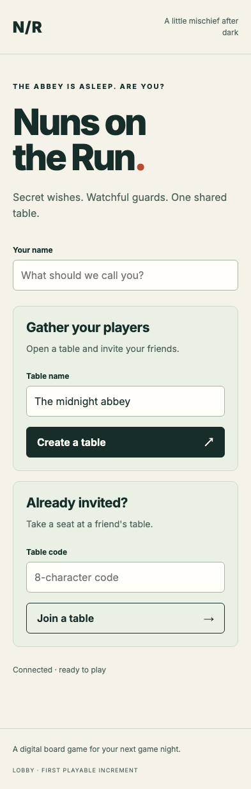
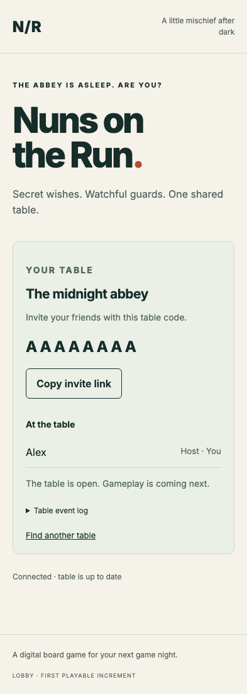
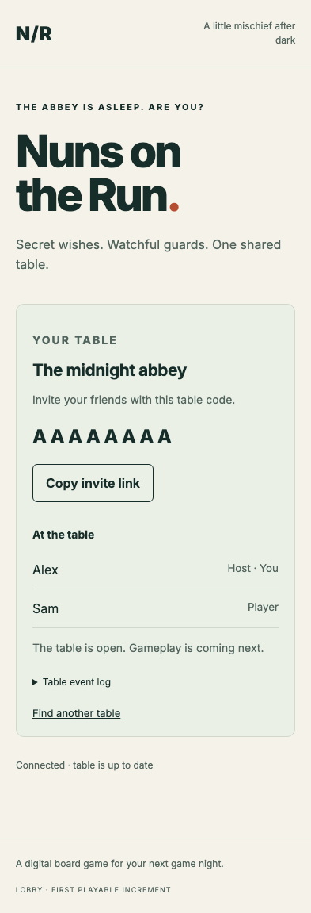

# Create and join a table

Two anonymous players share a table backed by the immutable Firestore event log.

## Find a table

- [x] Anonymous authentication enables creating and joining.

## Host opens the table

- [x] The host appears in the roster with an invitation code.

## A friend joins from a separate device

- [x] The host receives the guest through the Firestore subscription.

## Reload restores the same table and seat

- [x] The original anonymous identity and both seats survive reload.
- [x] There are exactly two immutable facts; reload did not add an event.
- [x] Both browser contexts run without uncaught application errors.
